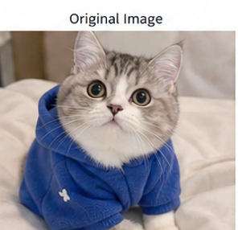
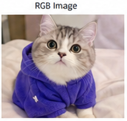
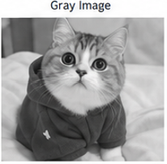

# 实验二：图像增强实验报告

## 一、实验目的
学会 OpenCV 的基本使用方法，掌握图像的读取、显示与保存操作。
利用 OpenCV、scikit-image 等计算机视觉库对图像进行平滑、滤波等操作，实现图像增强。
理解常见图像噪声（椒盐噪声、高斯噪声）的成因与表现，掌握均值滤波、中值滤波、高斯滤波的基本原理与适用场景。
通过手动实现彩色图像的中值滤波，加深对滤波算法原理及彩色图像通道处理方法的理解。

## 二、实验内容与结果分析

### 3.1 原始图像与颜色空间转换
通过 OpenCV 读取图像并显示，可以清楚看到原始彩色图像的细节。将 BGR 格式转换为 RGB 格式后，颜色显示更符合人眼认知，红、绿、蓝通道正确对应；灰度图则突出图像的亮度信息，有助于后续图像处理分析。

**1. 读取与显示原始图像：**
```python
# 2.1 导入依赖库
import cv2
from skimage.util import random_noise
import numpy as np
from matplotlib import pyplot as plt

# 2.2 读取原始图像并进行颜色空间转换
img = cv2.imread('p1.jpg')
(b, g, r) = img[100, 100]
print(b, g, r)  # 输出像素点的BGR值
plt.imshow(img)
plt.title('Original Image')
plt.axis('off')
plt.show()
```


```
2. 颜色空间转换（RGB与灰度图）：

python
# 2.3 颜色空间转换
# BGR 转换为 RGB
rgb_img = cv2.cvtColor(img, cv2.COLOR_BGR2RGB)
plt.imshow(rgb_img)
plt.title('RGB Image')
plt.axis('off')
plt.show()
```

```
# 转换为灰度图
gray_img = cv2.cvtColor(img, cv2.COLOR_BGR2GRAY)
plt.imshow(gray_img, cmap='gray')
plt.title('Gray Image')
plt.axis('off')
plt.show()
https://image/rgb.png
https://image/gray.png
```


3.2 噪声添加效果
结果分析：
椒盐噪声在图像中随机出现黑白点，使图像部分区域明显被破坏；高斯噪声使整个图像亮度轻微抖动，噪声分布更加均匀，整体细节略模糊。对比可见，椒盐噪声的局部破坏更明显，高斯噪声则影响全局视觉效果。

3.3 滤波去噪效果
结果分析：

均值滤波：对高斯噪声的去除效果较好，能够平滑整幅图像，但对椒盐噪声中的尖锐黑白点去除不彻底，且容易造成边缘模糊。

中值滤波：对椒盐噪声的去除效果显著，能有效保留图像边缘和细节；对高斯噪声也有一定抑制作用，但整体去噪效果略逊于均值滤波。

高斯滤波：对高斯噪声的去除效果最佳，平滑自然，且保留了一定边缘信息；但对椒盐噪声的处理能力有限，因为椒盐噪声是突变的而非连续分布。

手动实现中值滤波：效果与 OpenCV 自带中值滤波基本一致，能有效去除彩色图像中的椒盐噪声，并保持颜色真实和边缘清晰，验证了对彩色图像应分别对 R、G、B 三通道独立滤波的合理性。

## 三、总体分析
不同类型的噪声适合采用不同的滤波方法：
- 椒盐噪声属于突变型噪声，**中值滤波**能有效去除孤立的黑白噪点，同时较好地保留图像边缘细节；
- 高斯噪声属于连续分布型噪声，**高斯滤波**和**均值滤波**能起到较好的平滑去噪作用。
在后续的图像处理任务中，应根据实际噪声类型选择匹配的滤波算法，以达到最佳的图像增强效果。
